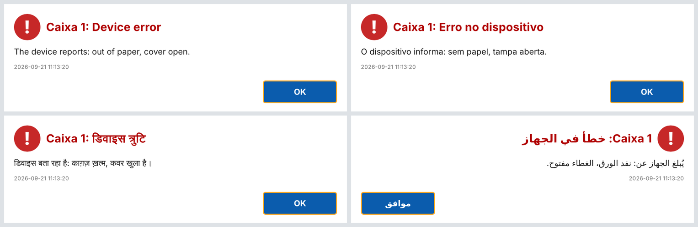

# netdevwatchdog

[](https://github.com/psqli/netdevwatchdog/actions/workflows/ci.yml)

Watches network printers and other devices and raises an alert that says **what kind** of failure it is, so whoever is nearby can act before power-cycling the device destroys the evidence.

Written in Rust with a [Slint](https://slint.dev) user interface. On a desktop (Windows, or Linux with X11/Wayland) it runs in the notification area and opens a large, always-on-top alert window that stays until someone presses OK. On a server or a Raspberry Pi it runs as a console service under systemd. Messages are built in for English, Portuguese, Spanish, Hindi, Chinese and Arabic.

This is a port of [NetworkDeviceWatchdog](https://github.com/psqli/NetworkDeviceWatchdog) (C#/.NET). It uses the same configuration file and locale files.



## What it detects

Every interval, each device's checks run in order; the first one that fails decides the diagnosis. An alert is raised only after the same device fails `failThreshold` checks in a row, once per incident, plus a notice when it recovers. Devices are checked concurrently, so one dead device does not delay the others.

| Diagnosis | How it is detected | Typical cause |
| --- | --- | --- |
| **No network** | No ping reply | Device off, cable or switch port, IP address changed |
| **IP address conflict** | The device's IP answers with another MAC address | Another device took its IP (same subnet only) |
| **Port blocked** | Ping works, the TCP port refuses or ignores connections | Port held by a stale connection, network board hung |
| **Not responding** | Port connects, but the device does not answer its protocol | Printer stopped reading data |
| **Device error** | The device answers and reports an error | Cover open, out of paper, jam, cutter error, toner empty |
| **Print queue error** | A Windows print job is in an error state | Job stuck in the spooler |
| **Print job stuck** | This computer keeps a raw print connection open for too long | Printer stopped reading in the middle of a job |
| **Health check failed** | HTTP endpoint returns the wrong status or content | Service on an embedded device is down |

## Device types

| `type` | Checks | Use for |
| --- | --- | --- |
| `escpos-printer` | ping, MAC, ESC/POS real-time status (`DLE EOT`) on port 9100, stuck-job detection, Windows queue | Thermal receipt and kitchen printers (ELGIN, Epson TM, Bematech, ...) |
| `printer` | ping, MAC, IPP printer state on port 631, Windows queue | Office printers (IPP Everywhere / AirPrint) |
| `generic` | ping, MAC, any TCP ports, optional HTTP(S) health check | Embedded devices, gateways, cameras, controllers |

Every type also accepts `tcpPorts` and `http` for extra checks.

The ESC/POS probe holds the printer's port for a fraction of a second and always closes it: many of these printers accept a single connection at a time. If this computer is printing to that printer at that moment, the round is skipped.

## Quick start

### Windows

1. Download `netdevwatchdog-windows-x64` from the latest [CI run](https://github.com/psqli/netdevwatchdog/actions) and unzip it.
2. Create the configuration and edit it:
   ```powershell
   .\netdevwatchdog.exe --init | Out-String
   notepad "$env:LOCALAPPDATA\NetworkDeviceWatchdog\watchdog.json"
   ```
3. Check it and look at the devices once:
   ```powershell
   .\netdevwatchdog.exe --once | Out-String
   .\netdevwatchdog.exe --test-alert
   ```
4. Start it at every logon (no administrator rights needed) and now:
   ```powershell
   .\netdevwatchdog.exe --install | Out-String
   ```

It then sits in the notification area: the icon is green when every device is OK and red when one has a problem. Right-click for the status of each device, **Check now**, **Edit configuration** and **Open log folder**. Saving the configuration reloads it automatically; if the new file has errors, the previous configuration keeps running and a notification says why.

The Windows build is a GUI program, so it never opens a console window. To see command-line output in PowerShell, pipe it (`| Out-String`), as above.

### Linux

```sh
./netdevwatchdog --init
nano ~/.config/network-device-watchdog/watchdog.json
./netdevwatchdog --once
./netdevwatchdog --install        # writes a systemd user service
systemctl --user enable --now network-device-watchdog
```

When started in a desktop session (`DISPLAY` or `WAYLAND_DISPLAY` set), the watchdog shows alert windows, desktop notifications and a status icon (on desktops with a StatusNotifierItem tray, such as KDE, or GNOME with the AppIndicator extension). Otherwise it runs as a console service and alerts go to the log and to [ntfy](#phone-alerts-with-ntfy) or a [command](#other-integrations).

The `linux-*-headless` downloads have no user interface and need only the standard C runtime libraries, for servers and Raspberry Pis.

## Configuration

The configuration is JSON; comments and trailing commas are allowed, and unknown settings are rejected so typos do not go unnoticed. See [`watchdog.json`](watchdog.json) for a complete, commented example (`--init` writes the same file). `--validate` checks a file.

The file is looked up in this order: `--config <file>`, then `watchdog.json` next to the program (portable use), then the user folder (`%LOCALAPPDATA%\NetworkDeviceWatchdog` on Windows, `~/.config/network-device-watchdog` elsewhere).

```jsonc
{
  "language": "auto",            // or en, pt, es, hi, zh, ar (any tag such as pt-BR works)
  "intervalSeconds": 60,
  "failThreshold": 3,
  "busyThreshold": 10,
  "notifications": {
    "desktop": true,             // desktop notification
    "alertWindow": true,         // alert window that stays until OK is pressed
    "alertFontSize": 18,
    "ntfyUrl": "https://ntfy.sh/your-hard-to-guess-topic",
    "notifyRecovery": true
  },
  "devices": [
    { "name": "Cashier", "type": "escpos-printer", "host": "192.168.10.21",
      "mac": "00-11-22-33-44-55", "windowsQueue": "ELGIN i9 Cashier" },
    { "name": "Office", "type": "printer", "host": "192.168.10.30" },
    { "name": "Gateway", "type": "generic", "host": "192.168.10.40", "tcpPorts": [1883],
      "http": { "url": "http://192.168.10.40/health", "expectStatus": 200, "expectBodyContains": "ok" } }
  ]
}
```

### Device settings

| Setting | Default | Meaning |
| --- | --- | --- |
| `name` | (required) | Shown in alerts; must be unique |
| `type` | `generic` | `escpos-printer`, `printer` or `generic` |
| `host` | (required) | IP address or host name |
| `port` | 9100 / 631 / none | Main port of the device type |
| `mac` | none | Expected MAC address; enables IP-conflict detection |
| `ping` | `true` | Set to `false` for devices that block ICMP |
| `windowsQueue` | none | Windows printer name to watch for jobs in error |
| `tcpPorts` | none | Extra ports that must accept connections |
| `http` | none | `url`, `expectStatus`, `expectBodyContains`, `ignoreCertificateErrors` |
| `ipp` | `{ "path": "/ipp/print" }` | For `printer`: `enabled`, `path`, `tls` |
| `enabled` | `true` | Keep a device in the file without monitoring it |

Global timeouts are under `timeouts` (`pingMs`, `connectMs`, `readMs`, `httpMs`). Logs go to a `logs` folder next to the configuration file, one file per month (`logDirectory` changes it; `%VARIABLES%` are expanded).

On Linux, ping uses an unprivileged ICMP socket when the kernel allows it (`net.ipv4.ping_group_range`) and otherwise the system `ping` program.

### Phone alerts with ntfy

Install the [ntfy](https://ntfy.sh) app, subscribe to a topic with a long random name, and set `notifications.ntfyUrl` to `https://ntfy.sh/<topic>`. For protected or self-hosted servers, also set `ntfyToken`.

### Other integrations

`notifications.command` runs a program for every alert and recovery, for e-mail, SMS gateways, MQTT or home automation:

```jsonc
"command": {
  "path": "/usr/local/bin/send-alert",
  "arguments": ["{kind}", "{device}", "{title}", "{body}"],
  "timeoutSeconds": 30
}
```

Placeholders: `{kind}` (`problem`, `recovery`, `test`), `{device}`, `{host}`, `{failure}`, `{title}`, `{body}`, `{time}`. The same values are passed as environment variables `NDW_KIND`, `NDW_DEVICE`, ...

Notification channels run independently: if one fails (no internet for ntfy, say), the alert window still opens and the failure is logged.

## Command line

```
netdevwatchdog [command] [--config <file>] [--language <tag>]

  (none)          Run the watchdog (desktop: in the notification area)
  --once          Check every device once and print the result (exit code 1 if any problem)
  --test-alert    Send a test alert through every channel
  --validate      Check the configuration file
  --init          Write a sample configuration (--force to overwrite)
  --install       Start automatically at logon (Windows) / write a systemd user service (Linux)
  --uninstall     Undo --install and stop the running watchdog
```

Only one watchdog runs per user; a second start reports that it is already running.

## Languages

Text is looked up by key with named placeholders (`{host}`, `{port}`), so translations can order words freely. The locale is chosen from `language` (or `--language`), falling back from the full tag to the language (`pt-BR` → `pt`) and finally to English. Arabic is laid out right to left; Hindi and Chinese use a suitable Windows font.

Built-in locales live in [`locales`](locales). A test makes sure every locale has exactly the English keys and the same placeholders, and another renders the alert window in every language.

To add a language or adjust wording without rebuilding, put `<code>.json` files in a `locales` folder next to the configuration file (or set `localesDirectory`). They use the same format as the built-in files, and any string they define replaces the built-in one:

```json
{ "language": "Deutsch", "direction": "ltr", "fontFamily": "Segoe UI",
  "strings": { "failure.unreachable": "Kein Netzwerk" } }
```

The Hindi, Chinese and Arabic texts were translated with AI assistance and have not yet been reviewed by native speakers. Corrections are welcome.

## Building

Requires Rust 1.89 or later. On Linux the desktop build also needs the fontconfig development package (`libfontconfig1-dev` on Debian and Ubuntu).

```sh
cargo build --release                         # with the desktop user interface
cargo build --release --no-default-features   # headless (console service only)
cargo test
```

The tests run fake ESC/POS printers, IPP printers and HTTP devices on loopback sockets, run the program itself through its command line (including live reload and `--uninstall`), and render the alert window offscreen with Slint's software renderer, so no hardware or display is needed. The rendered images are left in `target/tmp`.

| Path | Contents |
| --- | --- |
| `src/config.rs` | Configuration file (JSON with comments), validation |
| `src/checks/` | Ping, ARP, TCP, ESC/POS, IPP, HTTP and print-queue checks |
| `src/probe.rs`, `src/monitor.rs` | Check order per device type; failure threshold and recovery state machine |
| `src/service.rs`, `src/notify.rs` | Check rounds, log, ntfy and command notifications |
| `src/i18n.rs`, `locales/` | Localization |
| `src/platform/` | ARP table, connection table, ICMP and print spooler (Windows and Linux) |
| `src/gui/`, `ui/` | Slint alert window and notification-area icon, desktop notifications |
| `src/app/` | Command line, configuration lookup, live reload, single instance, start at logon |
| `tests/` | Integration tests |
